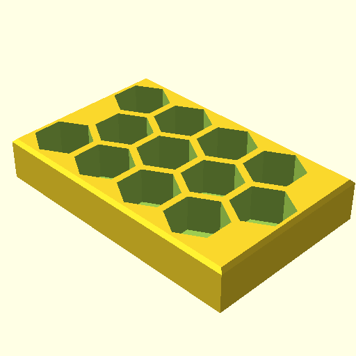
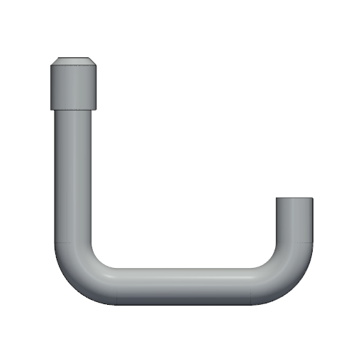
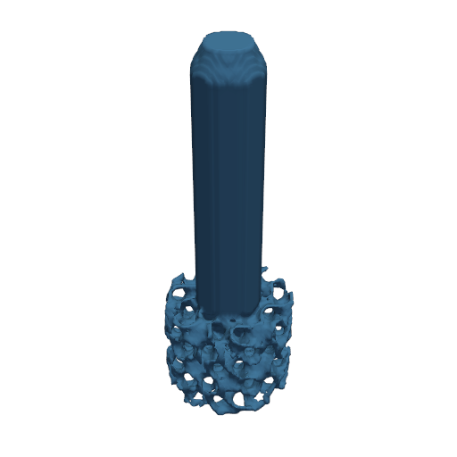
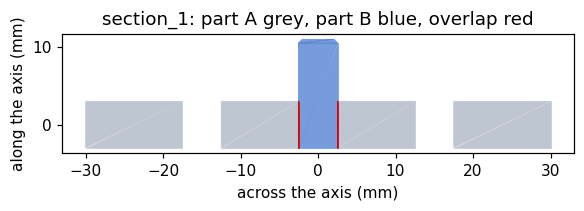
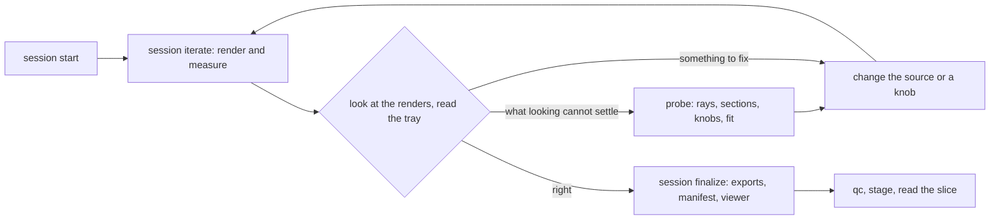
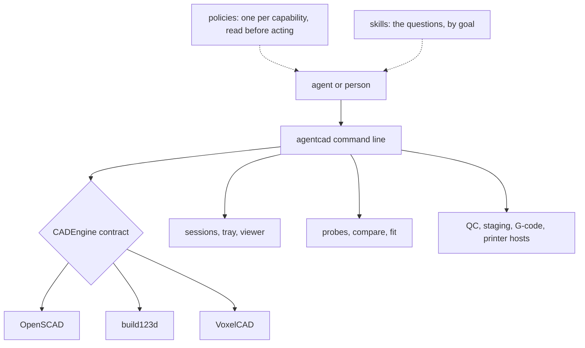

# AgentCAD

A design loop for an AI agent and parametric CAD: write the part as code, render and measure it, look, change it, and know when it is right. One command line drives three CAD kernels (build123d, OpenSCAD, VoxelCAD), and every capability ships with a policy the agent reads before it acts.

| | | | |
|:---:|:---:|:---:|:---:|
|  |  |  |  |
| OpenSCAD: a tray, fixed in three iterations | build123d: a hook, and when to stop | VoxelCAD: a lattice, judged on the right printer | a fit with both bodies: the overlap in red |

Each picture comes from a [walkthrough](#walkthroughs) that runs as printed, replayed by `python examples/build_walkthroughs.py`.

## Start here

**As a person**

```bash
pip install -e ".[build123d]"            # OpenSCAD and VoxelCAD are optional engines
agentcad info                             # which engines are installed here
agentcad session start examples/hex_tray
agentcad session iterate examples/hex_tray examples/hex_tray/source/hex_tray.scad
```

Then open the four renders the iterate printed, and read [the hex tray walkthrough](examples/hex_tray/WALKTHROUGH.md) to see what they show.

**As an agent**

```bash
pip install -e ".[build123d]"
agentcad policy navigate start            # agentcad by goal: the skill, the policies and the first command
agentcad plugin export --target claude-code -o agentcad-plugin    # the skills, for a harness that loads plugins
```

Every agent harness reads the same know-how in its own form: a plugin (`claude-code`), a policy root for the [MacEff](https://github.com/cversek/MacEff) agent framework (`maceff`), one [AGENTS.md](AGENTS.md) (`agents-md`), or tool definitions for a model API (`api-tools`).

## Skills

| Skill | Use it when | Walkthrough |
|---|---|---|
| `start` | you have a goal and no map of the commands | (routes to the others) |
| `design-session` | designing, revising or replicating a part | [hex tray](examples/hex_tray/WALKTHROUGH.md), [J-hook](examples/j_hook/WALKTHROUGH.md), [gyroid plug](examples/gyroid_support_plug/WALKTHROUGH.md) |
| `render-gate` | any image or page agentcad produced is about to be acted on | every walkthrough's "Looked at" |
| `fit-check` | two parts must mate | [peg and plate](examples/peg_plate/WALKTHROUGH.md) |
| `reverse-engineer` | a part exists only as a STEP, a mesh or a design record | [plate from its STEP](examples/plate_recovery/WALKTHROUGH.md) |
| `print-prep` | a finished part is headed for a printer | [hex tray, part 2](examples/hex_tray/WALKTHROUGH.md#part-2-from-the-finished-tray-to-a-checked-slice) |
| `review` | before calling a design done, or reviewing someone else's | `agentcad policy navigate design-review` |

A skill asks; the policies answer. Each one reads the installed version's policies when it runs (`agentcad policy list`), so it never goes stale.

## The loop



## Walkthroughs

Each walkthrough is one session as an agent lives it: the goal, the skill and the policies read, the commands as typed, every iteration's pictures with what was seen and what was changed. `python examples/build_walkthroughs.py` runs every command in them and rebuilds the pictures; `--verify` checks them without writing.

- [A hex tray in OpenSCAD](examples/hex_tray/WALKTHROUGH.md): pockets that meet at their corners, found by looking and measured by QC, fixed in two steps; then staged and its slice checked.
- [A pegboard hook in build123d](examples/j_hook/WALKTHROUGH.md): three print orientations tried, a quiet QC report that broke the peg's fit, and a decision.
- [A gyroid support plug in VoxelCAD](examples/gyroid_support_plug/WALKTHROUGH.md): the right printer, a part in pieces the render could not show, and a skin whose cost only the render showed.
- [A peg and its plate](examples/peg_plate/WALKTHROUGH.md): a clearance chosen with both bodies, an insertion sweep, and a pass read with its number.
- [A plate rebuilt from its STEP](examples/plate_recovery/WALKTHROUGH.md): numbers recovered by the probes, not traced, and a gate that passed while the windows did not.

## How it is built



## More

- [Reference](docs/reference.md): every engine, command family and convention in full.
- Policies: `agentcad policy list`, then `navigate` and `read`; [how they are written](docs/reference.md#policies).
- [The gallery](https://manny-dev-neurofieldz.github.io/agentcad/): every example built by CI, each with its viewer.
- [Where the guidance came from](docs/policy_ledger.md).

## License

MIT
