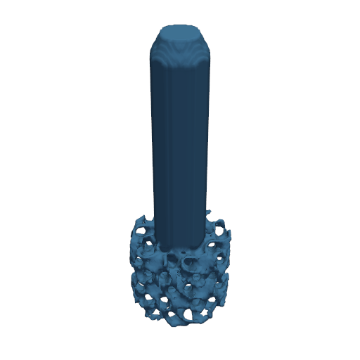
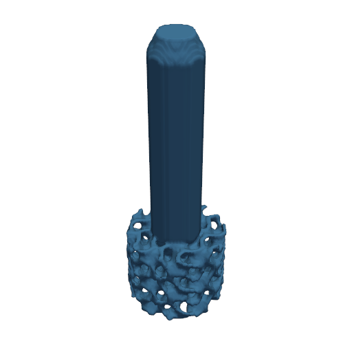
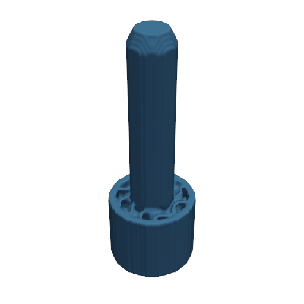

# Walkthrough: a gyroid support plug in VoxelCAD, judged against the right printer

A flexible gyroid body under a friction-fit plug, built on a voxel grid. The lattice's sheets are meant to be thin. This walkthrough is one session that first judges the part against the wrong printer, then the right one, then makes two changes and looks at what each costs. It ends with a decision left to the designer, as a real session often does. Every command runs in CI exactly as printed, and the pictures are rebuilt from it.

**Skill**: design-session, then render-gate (see `agentcad policy navigate start`).
**Policies read**: `engines` (why VoxelCAD: a lattice is a field, not faces; what `resolution_mm` means), `qc` (the printer the rules come from), `session` (the tray's solid count).

## Iteration 1: judged against the default printer

```console
# recipe: examples
$ agentcad session start examples/gyroid_support_plug
Session started for project 'gyroid_support_plug'
$ agentcad session iterate examples/gyroid_support_plug examples/gyroid_support_plug/source/gyroid_support_plug.py
Iteration v1 recorded
counts     solids 1
# image: examples/gyroid_support_plug/_work/v1/gyroid_support_plug_v1_iso.png -> v1_iso.png
$ agentcad qc examples/gyroid_support_plug
against Original Prusa MK4
warning: max_overhang
qc: 0 error(s)
```



**Looked at**: the plug on a short open lattice of gyroid sheets. **Measured**: one solid, and hundreds of QC warnings, nearly all overhangs across the lattice. They are true of an FDM printer, and beside the point: this part prints in resin. QC judges against the project's printer, which here is the default.

## Iteration 2: the printer it is made on

```console
# recipe: examples
$ agentcad session start examples/gyroid_support_plug
Session started
$ agentcad session iterate examples/gyroid_support_plug examples/gyroid_support_plug/source/gyroid_support_plug.py
Iteration v1 recorded
$ agentcad qc examples/gyroid_support_plug --printer form3
against Formlabs Form 3
warning: min_feature
limits: min_wall_mm 0.4 (process default (resin)), min_feature_mm 0.3
not measured: max_overhang (no overhang limit for this process
```

**Measured**: the overhang rule does not apply to this process, and about a hundred warnings remain: slivers of sheet a few hundredths of a millimetre thick where the body's cylinder trims the lattice, under the resin process's 0.3 mm. (A project states its printer in `[qc] printer`; `--printer` tries one without editing the file.)

**Changed**: thicker sheets, `wall` from 0.35 to 0.5.

## Iteration 3: thicker sheets

```console
# recipe: examples
$ agentcad session start examples/gyroid_support_plug
Session started
$ agentcad session iterate examples/gyroid_support_plug examples/gyroid_support_plug/source/gyroid_support_plug.py -D wall=0.5
Iteration v1 recorded
the part is in pieces
# image: examples/gyroid_support_plug/_work/v1/gyroid_support_plug_v1_iso.png -> v3_iso.png
$ agentcad qc examples/gyroid_support_plug --printer form3
qc: 0 error(s)
```



**Looked at**: one plug on an open lattice, the same as before to the eye. **Measured**: QC drops to a handful of warnings, and the tray says the part is in pieces: islands of sheet cut off at the cylinder's edge, which a render at this size cannot show. A loose island in a resin print is debris in the tank.

**Changed**: a thin skin round the lattice to tie the cut sheet ends together (`walkthrough/skin.py`, a `skin` knob).

## Iteration 4: a skin round the lattice

```console
# recipe: examples
$ agentcad session start examples/gyroid_support_plug
Session started
$ agentcad session iterate examples/gyroid_support_plug examples/gyroid_support_plug/walkthrough/skin.py -D wall=0.5 -D skin=0.5
Iteration v1 recorded
counts     solids 1
# image: examples/gyroid_support_plug/_work/v1/gyroid_support_plug_v1_iso.png -> v4_iso.png
$ agentcad qc examples/gyroid_support_plug --printer form3
qc: 0 error(s)
```



**Measured**: one solid, and a few warnings left: floors of about 0.27 mm against 0.3, about two voxels at this grid, which a finer `voxel_size` would settle either way. **Looked at**: and here the render changes the answer. The skin has closed the open lattice into a solid-walled cup, which makes a support meant to be flexible stiffer, and no number above says so.

## The decision this session leaves

Two ways to keep the part in one piece, each with a cost the instruments show differently: a skin (one solid, stiffer, closed; seen in the render) or dropping the loose islands with `[engine.voxelcad] only_largest_component = true` (the lattice stays open; the islands are lost, which the volume shows). Which one is right depends on how flexible the support must be, which is the designer's call, made with both renders side by side.

## What this session shows

- QC's rules come from a printer; judge against the one the part is made on.
- A quieter QC report can arrive with a worse part: the tray's solid count caught the pieces.
- The render caught what no number did: the skin's cost to the part's job.
