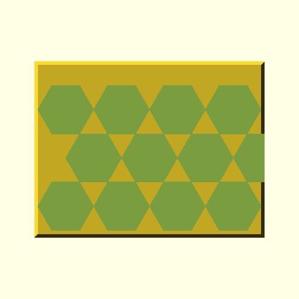
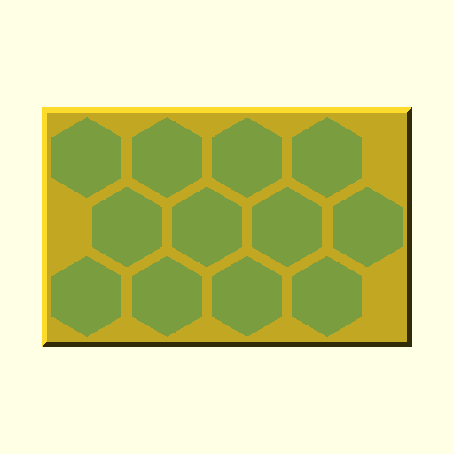
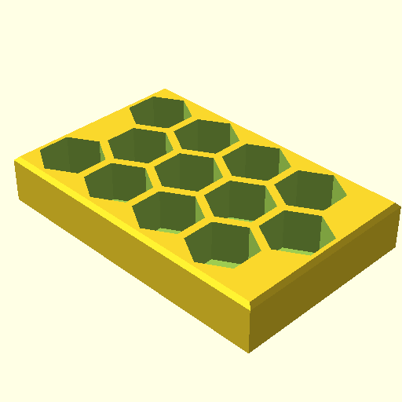

# Walkthrough: a hex tray in OpenSCAD, from a defect to a part that prints

A tray of hexagonal pockets for small parts. The source in `source/` looks reasonable and renders, and it has a defect a printer would find. This walkthrough is one design session as an agent lives it: look at each iteration, measure what looking suggests, change the source, and look again until the part is right. Every command below runs exactly as printed (`python examples/build_walkthroughs.py --verify` replays it), and the pictures are rebuilt from it.

**Skill**: design-session, then render-gate and print-prep (`agentcad plugin export --target claude-code`, see `agentcad policy navigate start`).
**Policies read**: `start` (goal: design a part), `engines` (why OpenSCAD: a parametric family of plain CSG), `session` (the loop and the render gate), `qc` (the printer's design rules).

## The goal

Twelve hexagonal pockets, 14 mm across their flats, 10 mm deep, in three staggered rows, with 2 mm walls between them, for an FDM printer with a 0.4 mm nozzle.

## Iteration 1: the source as written

```console
# recipe: examples
$ agentcad session start examples/hex_tray
Session started for project 'hex_tray'
$ agentcad session iterate examples/hex_tray examples/hex_tray/source/hex_tray.scad
Iteration v1 recorded
bbox       [66, 50.57, 12]
counts     solids 1
# image: examples/hex_tray/_work/v1/hex_tray_v1_top.png -> v1_top.png
# image: examples/hex_tray/_work/v1/hex_tray_v1_iso.png -> v1_iso.png
$ agentcad qc examples/hex_tray
warning: min_wall: a wall 0.564 mm thick
qc: 0 error(s), 27 warning(s)
```



**Looked at**: the top view shows hexagons with a corner, not a flat, facing along each row, so neighbours in a row meet corner to corner with only small triangles of material between them, and the last pocket of the middle row runs out through the right edge. One solid, so the tray is still in one piece.

**Measured**: QC puts numbers on it: walls of 0.56 mm between the offset rows, against the 0.9 mm the printer's process asks for, and slivers along the rim.

**Changed**: the source draws `cylinder($fn = 6)`, which puts a corner on the x axis. Turned 30 degrees, every neighbour meets flat to flat across the intended 2 mm wall.

## Iteration 2: the pockets turned

```console
# recipe: examples
$ agentcad session start examples/hex_tray
Session started
$ agentcad session iterate examples/hex_tray examples/hex_tray/source/hex_tray.scad
Iteration v1 recorded
$ agentcad session iterate examples/hex_tray examples/hex_tray/walkthrough/v2.scad
Iteration v2 recorded
counts     solids 1 (+0)
# image: examples/hex_tray/_work/v2/hex_tray_v2_top.png -> v2_top.png
$ agentcad qc examples/hex_tray
qc: 0 error(s), 6 warning(s)
```


**Looked at**: even webs between every pair of pockets now. But the middle row's last pocket still breaks through the right edge, and the bottom row's points reach the front edge.

**Measured**: six warnings left, all at the outline: slivers along the front edge and thin wall at the right.

**Changed**: the outline was computed for the old orientation. The new source derives it from the pockets themselves: their size across the corners, the half pitch the odd rows sit over, and a wall all round.

## Iteration 3: the outline derived from the pockets

```console
# recipe: examples
$ agentcad session start examples/hex_tray
Session started
$ agentcad session iterate examples/hex_tray examples/hex_tray/source/hex_tray.scad
Iteration v1 recorded
$ agentcad session iterate examples/hex_tray examples/hex_tray/walkthrough/v2.scad
Iteration v2 recorded
$ agentcad session iterate examples/hex_tray examples/hex_tray/walkthrough/v3.scad
Iteration v3 recorded
bbox       [74, 47.88, 12] (+8, -2.689, +0)
counts     solids 1 (+0)
# image: examples/hex_tray/_work/v3/hex_tray_v3_top.png -> v3_top.png
# image: examples/hex_tray/_work/v3/hex_tray_v3_iso.png -> v3_iso.png
$ agentcad qc examples/hex_tray
qc: 0 error(s), 0 warning(s)
$ agentcad session finalize examples/hex_tray
Session finalized.
```




**Looked at**: every pocket inside the outline with a wall all round, the odd row's overhang carried by the extra 8 mm of width.

**Measured**: no QC warning. The tray grew 8 mm in x for the overhanging row and lost 2.7 mm in y, because a row is now spaced by the true honeycomb pitch.

**Finished**: the finalize writes the exports, the print manifest and the viewer. Next would be staging for a printer (the print-prep skill, `agentcad policy navigate print-intent`).

## What this session shows

- The render is the first instrument, not the last: it showed the corners meeting before QC did, and QC said by how much and where.
- A fix to one relation (the pocket's orientation) moved the defect to the relations that depended on it (the outline), which only a second look found.
- The outline is now derived from the pocket and the wall, so changing `across` or `wall` keeps it right.

## Part 2: from the finished tray to a checked slice

**Skill**: print-prep. **Policies read**: `qc`, `print-intent` (staging), `prusaslicer` (the base configuration), `gcode` (reading a slice against its intent).

The tray is staged for PrusaSlicer with its printer, filament and print settings taken from a file PrusaSlicer itself wrote; no slicer has to run to stage. The repository's test data holds one real slice, of the peg from `examples/peg_plate`, and an intent file for it that asks for finer layers than the slice has.

```console
# recipe: fixtures
$ agentcad session start examples/hex_tray
Session started
$ agentcad session iterate examples/hex_tray examples/hex_tray/walkthrough/v3.scad
Iteration v1 recorded
# image: examples/hex_tray/_work/v1/hex_tray_v1_iso.png -> staged_iso.png
$ agentcad qc examples/hex_tray
qc: 0 error(s), 0 warning(s)
$ agentcad session finalize examples/hex_tray
Session finalized.
$ agentcad stage examples/hex_tray --target prusaslicer --base-config fixtures/golden_pair/peg.bgcode -o staged
staged hex_tray for prusaslicer on MK4IS (its bed from peg.bgcode)
staged/hex_tray.3mf
$ agentcad gcode check staged/hex_tray.3mf
layer_height = 0.2
```


**Staged**: a PrusaSlicer project with the tray placed on the bed the configuration describes, carrying the configuration's 0.2 mm layers, readable before anything is sliced.

Once sliced, the file is read against the intent before it prints. Here a real slice is checked against an intent that asked for 0.15 mm layers:

```console
# recipe: fixtures
$ agentcad gcode summary fixtures/golden_pair/peg.bgcode
70 layers to z 14.0
$ agentcad gcode check fixtures/golden_pair/peg.bgcode --intent fixtures/golden_pair/peg_intent.toml
# exit 1
ERROR: layer_height is 0.2 in the file; peg_intent.toml [slice] asks for 0.15
```

**Read**: the slice is 70 layers of 0.2 mm, and the check names the one setting that disagrees, both values, and the usual cause (a preset chosen after the project was loaded). The file is re-sliced from the project, not sent to the printer; upload and start belong to whoever runs the printer.
