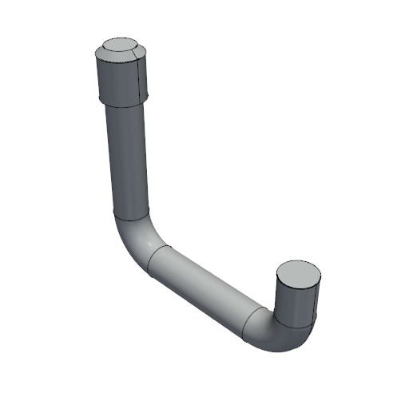
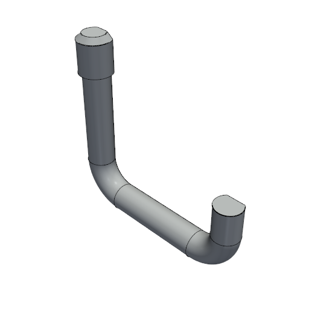
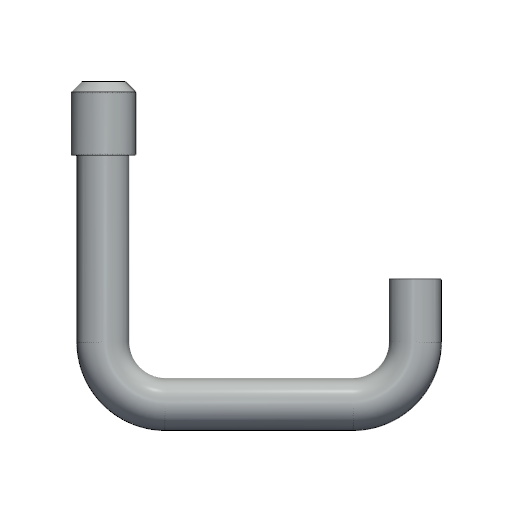

# Walkthrough: a pegboard hook in build123d, and when to stop changing the part

A J-shaped hook swept from a round section, with a peg that plugs a pegboard hole. The design question here is how it prints. This walkthrough is one session that tries three answers, measures each, and ends on a decision rather than on a quiet QC report. Every command below runs exactly as printed (`python examples/build_walkthroughs.py --verify` replays it), and the pictures are rebuilt from it.

**Skill**: design-session, then render-gate and print-prep (see `agentcad policy navigate start`).
**Policies read**: `engines` (why build123d: a swept B-rep with exact faces to measure), `design-practice` (pin the load-bearing dimension, a feature is a delta), `qc` (overhangs, the print pose, suppressions with a reason), `probe-inspect` (rays).

## The goal

A hook for a pegboard with 6.35 mm holes: the peg must stay 6.2 mm round to sit in the hole, and the part must print on an FDM printer without overhangs it cannot make.

## Iteration 1: as modelled, peg up

```console
# recipe: examples
$ agentcad session start examples/j_hook
Session started for project 'j_hook'
$ agentcad session iterate examples/j_hook examples/j_hook/source/j_hook.py
Iteration v1 recorded
counts     solids 1, faces 10
# image: examples/j_hook/_work/v1/j_hook_v1_iso.png -> v1_iso.png
$ agentcad qc examples/j_hook
warning: max_overhang: 72 mm2 of faces turned down up to 77 deg
warning: max_overhang: 11 mm2 of faces turned down up to 90 deg
qc: 0 error(s), 2 warning(s)
$ agentcad probe rays examples/j_hook/source/j_hook.py --line 0,-10,3:0,1,0 --length 20
material 6.2000 in 1 run(s)
```



**Looked at**: one swept hook, the peg on top, a smooth bend. **Measured**: one solid; the peg is 6.2 mm across, the pin for the fit. QC finds two overhangs past 45 degrees: the round underside of the bend, and the collar where the peg meets the thinner wire.

**Changed**: try laying the hook on its side, its plane flat on the bed, declared in the program with `print_pose`.

## Iteration 2: laid on its side

```console
# recipe: examples
$ agentcad session start examples/j_hook
Session started
$ agentcad session iterate examples/j_hook examples/j_hook/source/j_hook.py
Iteration v1 recorded
$ agentcad session iterate examples/j_hook examples/j_hook/walkthrough/v2.py
Iteration v2 recorded
source changed but nothing measurable did
$ agentcad qc examples/j_hook
pose up [0.0, -1.0, 0.0]
warning: max_overhang: 235 mm2 of faces turned down up to 90 deg
qc: 0 error(s), 4 warning(s)
```

**Looked at**: the same part; only its pose changed, which the tray says in its own words. **Measured**: worse, 235 mm2 of overhang: a round section lying down overhangs along its whole length.

**Changed**: cut the side that lies on the bed flat, at the depth where the round section's slope reaches 45 degrees, r (1 - cos 45).

## Iteration 3: a flat underside

```console
# recipe: examples
$ agentcad session start examples/j_hook
Session started
$ agentcad session iterate examples/j_hook examples/j_hook/walkthrough/v3.py
Iteration v1 recorded
# image: examples/j_hook/_work/v1/j_hook_v1_iso.png -> v3_iso.png
$ agentcad qc examples/j_hook
qc: 0 error(s), 0 warning(s)
$ agentcad probe rays examples/j_hook/walkthrough/v3.py --line 0,-10,3:0,1,0 --length 20
material 4.8678 in 1 run(s)
```



**Looked at**: the ends of the peg and of the lip are D-shaped now. **Measured**: QC is quiet, and the ray across the peg says why that is not the answer: the peg is 4.87 mm across where the hole needs 6.2. The flat cut through the peg as well.

**Changed**: nothing more to the shape. A round peg cannot lie flat on the bed with the hook, so laying the part down trades the fit for the print. Print it as modelled, peg up, and name the two overhangs QC found, each with its reason, in the program.

## Iteration 4: as modelled, the overhangs named

```console
# recipe: examples
$ agentcad session start examples/j_hook
Session started
$ agentcad session iterate examples/j_hook examples/j_hook/walkthrough/v4.py
Iteration v1 recorded
# image: examples/j_hook/_work/v1/j_hook_v1_front.png -> v4_front.png
$ agentcad qc examples/j_hook
suppressed: max_overhang
qc: 0 error(s), 0 warning(s)
$ agentcad probe rays examples/j_hook/walkthrough/v4.py --line 0,-10,3:0,1,0 --length 20
material 6.2000 in 1 run(s)
$ agentcad session finalize examples/j_hook
Session finalized.
```



**Measured**: the peg is 6.2 mm again, and QC reports both overhangs as suppressed, each with the line that suppressed it and why: the bend prints with supports, the collar is a 0.6 mm ledge round the wire.

## What this session shows

- A quiet QC report is not the goal; the part's job is. The ray on the peg, pinned in iteration 1, is what caught iteration 3.
- A change of pose is a change the tray cannot see; it said so, and QC measured it.
- A rule broken on purpose is named in the program with its reason, where a reviewer reads it, not silenced in a setting.
