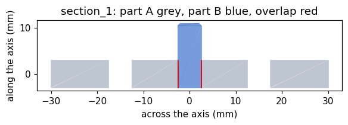
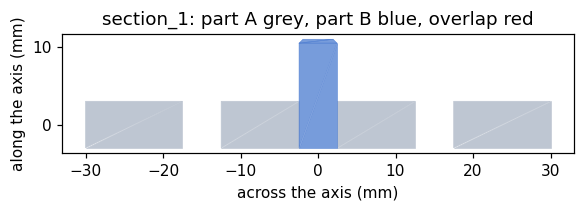

# Walkthrough: a peg and its plate, checked with both bodies

A plate with three holes and the peg that presses into them, built from one source with a `part` parameter. Each part on its own measures as designed at every step below; only a check with both bodies says whether they fit. This walkthrough sizes the peg's clearance in three tries. Every command runs exactly as printed (`python examples/build_walkthroughs.py --verify` replays it), and the pictures are rebuilt from it.

**Skill**: fit-check (see `agentcad policy navigate start`).
**Policies read**: `fit` (declaring a mate, posing the pair, windows, verdicts, the insertion sweep), `design-practice` (a mate is a hypothesis until both bodies are posed; as-printed is not nominal), `render-export` (a clearance plate).

## The mate

The project declares `[mates.middle_peg]`: the middle peg in the middle hole, a nominal gap of 0.05 mm with a tolerance of 0.05 mm. The plate declares the hole's axis and its underside; the peg declares its own axis and base. `fit` poses the peg from those datums. The peg's diameter is `hole_d - clearance`, so the source's `clearance` knob is the one being chosen.

## Try 1: a peg 0.1 mm over the hole

```console
# recipe: examples
$ agentcad fit examples/peg_plate/source/peg_plate.py examples/peg_plate/source/peg_plate.py --a-define part=plate --b-define part=peg --b-define clearance=-0.1 --mate middle_peg --a-mates examples/peg_plate/parts/plate --b-mates examples/peg_plate/parts/peg --sweep z --travel 4 --sweep-steps 2 -o fit_oversize
# exit 1
interference 4.76 mm^3; clearance 0 mm
insertion at 4 mm out: interference 1.587 mm^3
insertion at 0 mm out: interference 4.76 mm^3
# image: fit_oversize/fit_section_1.png -> try1_section.png
fit: INTERFERENCE (the bodies overlap)
```



**Looked at**: a section through the mate's axis, the plate grey, the peg blue, and a thin red band down each side of the peg through the plate: the overlap. **Measured**: 4.76 mm^3 of the peg inside the plate, growing steadily as the peg goes in, so it binds from the first millimetre rather than at a burr. The command exits 1.

## Try 2: line to line

```console
# recipe: examples
$ agentcad fit examples/peg_plate/source/peg_plate.py examples/peg_plate/source/peg_plate.py --a-define part=plate --b-define part=peg --b-define clearance=0 --mate middle_peg --a-mates examples/peg_plate/parts/plate --b-mates examples/peg_plate/parts/peg
interference 0 mm^3; clearance 0 mm
window middle_peg: PASS (clearance 0 mm; nominal 0.05 +/- 0.05 mm)
```

**Measured**: no overlap, and a PASS, at a clearance of exactly 0. The verdict guards against too tight a gap within its tolerance, and 0 is 0.05 below the nominal, on the edge. A pass is read with its number: a line-to-line press fit in a printed part will not go in.

## Try 3: the designed clearance

```console
# recipe: examples
$ agentcad fit examples/peg_plate/source/peg_plate.py examples/peg_plate/source/peg_plate.py --a-define part=plate --b-define part=peg --mate middle_peg --a-mates examples/peg_plate/parts/plate --b-mates examples/peg_plate/parts/peg -o fit_designed
interference 0 mm^3; clearance 0.05 mm
window middle_peg: PASS (clearance 0.05 mm; nominal 0.05 +/- 0.05 mm)
# image: fit_designed/fit_section_1.png -> try3_section.png
$ agentcad export examples/peg_plate/source/peg_plate.py -D part=peg --variants clearance=0.05,0.1,0.15 -o peg.stl
Exported: ...peg_clearance-0p05.stl (clearance=0.05
Exported: ...peg_clearance-0p15.stl (clearance=0.15
```



**Measured**: 0.05 mm all round, the nominal, with no overlap. **Next**: the nominal is a model's number. The printer takes its own share of a clearance, so three pegs are exported at 0.05, 0.1 and 0.15 to print beside one plate; the one that fits sets `clearance` in the source, and `agentcad fit ... --record` writes the result into both parts' manifests.

## What this session shows

- Each part alone is exactly as designed at every try; only the pair shows the fit.
- The insertion sweep tells binding all the way from a burr at the bottom.
- A PASS is a verdict on one side of a tolerance; the clearance beside it is the reading.
