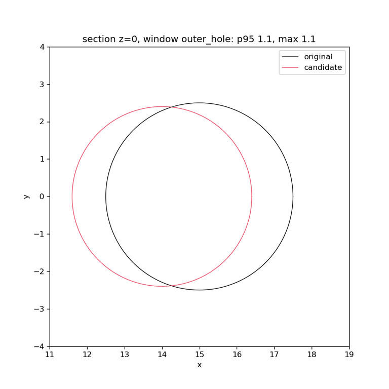
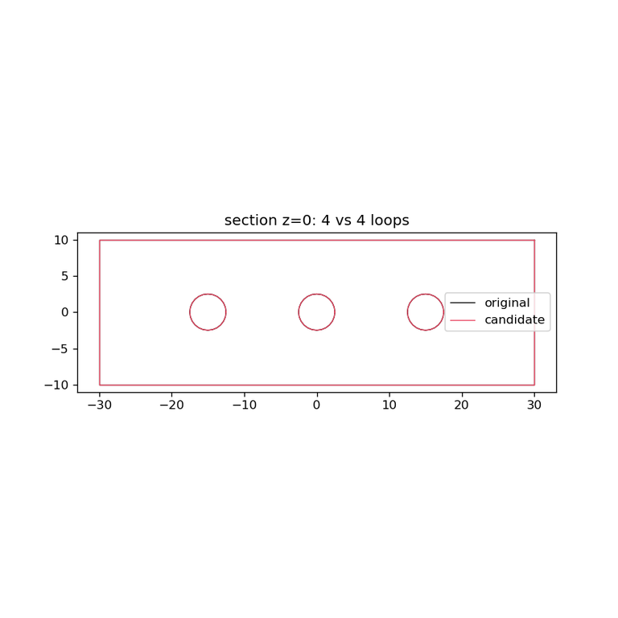

# Walkthrough: a plate rebuilt from its STEP, numbers recovered rather than guessed

An original part known only as a STEP file: a plate with a row of holes. The goal is a parametric program for it, with each number recovered by a probe, so the rebuild can be revised. This walkthrough starts the way a rebuild often starts, from numbers read off a picture, and lets the comparison say which are wrong. Every command runs in CI exactly as printed, and the pictures are rebuilt from it.

**Skill**: reverse-engineer (see `agentcad policy navigate start`).
**Policies read**: `reverse-engineering` (the order of work), `probe-inspect` (the inventory and its axes), `probe-recover` (sections read as arcs), `compare` (the gate, then the windows, then the deviation).

The original is written first in each block below, from the peg-and-plate example, only so that the walkthrough has a STEP to read; from then on the plate is treated as a file with no source.

## Iteration 1: numbers read off a picture

A top view suggests holes about 4.8 mm across, about 14 mm apart. The program `source/plate_rebuild.py` takes both as parameters.

```console
# recipe: examples
$ agentcad export examples/peg_plate/source/peg_plate.py -f step -D part=plate -o original.step
Exported:
$ agentcad compare original.step examples/plate_recovery/source/plate_rebuild.py --planes z=0 --window outer_hole=11,-4,19,4 --window middle_hole=-4,-4,4,4 -D pitch=14 -D hole_d=4.8 -o cmp_guess
z=0: loops 4 vs 4 ok
window outer_hole: p95 1.099, max 1.1
window middle_hole: p95 0.1, max 0.1
# image: cmp_guess/overlay_z_0_outer_hole.png -> v1_outer_hole.png
```



**Looked at**: the rebuild's outer hole sits a millimetre inboard of the original's and is a little smaller. **Measured**: the loop-count gate passes, 4 loops against 4, because every hole is there; only the windows find what is wrong. They also tell the two errors apart: the middle hole, which the pitch does not move, is off by 0.1 mm (the radius alone); the outer hole by 1.1 (the radius and the pitch).

## Iteration 2: the radius from a section, the pitch from the axes

```console
# recipe: examples
$ agentcad export examples/peg_plate/source/peg_plate.py -f step -D part=plate -o original.step
Exported:
$ agentcad probe inventory original.step
cylinder r 2.5: axis through (-15, 0, -4) along (0, 0, 1)
cylinder r 2.5: axis through (0, 0, -4) along (0, 0, 1)
cylinder r 2.5: axis through (15, 0, -4) along (0, 0, 1)
$ agentcad probe section original.step --planes z=0 --arcs
r 2.5000  center (-15.0000, 0.0000)  sweep 360.00 deg
```

**Measured**: three cylinders of radius 2.5 on axes 15 mm apart, and the section's arcs agree, exact edges with no fit error. So `hole_d = 5` and `pitch = 15`: the program's defaults, now that they are known.

## Iteration 3: the rebuild at the recovered numbers

```console
# recipe: examples
$ agentcad export examples/peg_plate/source/peg_plate.py -f step -D part=plate -o original.step
Exported:
$ agentcad compare original.step examples/plate_recovery/source/plate_rebuild.py --planes z=0 --window outer_hole=11,-4,19,4 --window middle_hole=-4,-4,4,4 -o cmp_recovered
z=0: loops 4 vs 4 ok
window outer_hole: p95 0, max 0
window middle_hole: p95 0, max 0
deviation candidate->original p95 0
# image: cmp_recovered/overlay_z_0.png -> v3_section.png
$ agentcad session start examples/plate_recovery
Session started
$ agentcad session iterate examples/plate_recovery examples/plate_recovery/source/plate_rebuild.py
counts     solids 1, faces 9
```



**Measured**: every window reads 0 and the deviation sits at its sampling floor; the rebuild has the original's 9 faces in one solid. The plate is now a program whose pitch and holes are knobs.

## What this session shows

- A passing loop gate says every feature is there, not that each is in its place: the windows say where.
- A window per feature separates errors that a single number would add together.
- A number read from a probe's exact edge (an axis, an arc) replaces a number read from a picture; nothing is traced.
