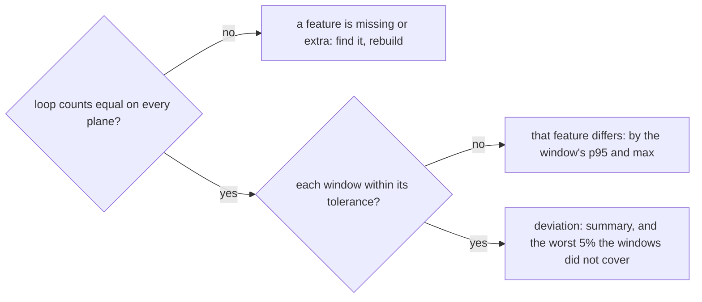

# Compare: Does the Candidate Match the Original, and Where Not

**Type**: Capability Policy (comparison)
**Scope**: Any agent or person matching a part to an original: a replication, a revision, a rebuild from a STEP
**Status**: ACTIVE
**Commands**: agentcad compare

## Purpose

A replication or a revision is judged against something: an original STEP, a reference program, an earlier revision. `agentcad compare` answers in three instruments of different strength: a gate on the number of section loops per plane, which catches a missing or extra feature outright; distances between the two sections inside named windows, which say where a feature differs and by how much; and a sampled deviation over the whole surface, which summarises. This policy says what each instrument measures, how to read it, and why the strongest number is rarely the smallest one.

## Reaching for It

- A rebuild or a revision judged against an original STEP, a reference program or an earlier revision: `agentcad compare`, with planes through every feature that matters.
- Two parts that must fit together, rather than match: `agentcad fit` (`agentcad-fit`).
- What an original is made of, before building anything: the probes (`agentcad-probe-recover`, `agentcad-probe-inspect`).
- One knob's effect on one part: `agentcad probe knobs` (`agentcad-probe-inspect`).

## CEP Navigation Guide

**1 What Compare Takes**
- Which sources can be compared, and with which instruments?
- How are a program's parameters overridden?

**2 The Loop-Count Gate**
- What does the gate compare, and when does it fail?
- What does a loop cap do to it?

**3 Windows and Overlays**
- How is a window named and placed on a section?
- What does a window report, and what images does compare write?

**4 Sampled Deviation**
- What does the deviation measure, in both directions?
- What sets its floor, and what does it not show?

**5 Reading a Comparison**
- In which order are the numbers read, and what does each prove?

**6 Recipes**
- What does a comparison that passes look like, and one whose gate fails?

**7 Constraints to Probe**
- Which limits of a comparison are found by a command before its numbers are trusted?

**8 Integration with Other Policies**
- Which policies feed and use a comparison?

**9 Anti-Patterns**
- Which readings of a comparison mislead?

**10 Evolution and Feedback**
- How does this policy change?

=== CEP_NAV_BOUNDARY ===

## 1 What Compare Takes

`agentcad compare ORIGINAL CANDIDATE` takes two sources. When both are exact (a STEP file or a build123d program), they are sectioned on the planes named by `--planes` and compared loop by loop, then sampled; when either is a mesh (an STL), only the sampled deviation is reported, and a note says the loops were not compared. `-D`/`--define VAR=VAL` (repeatable) overrides a parameter of the candidate when it is a program; the original is read as it is. For a STEP or STL candidate, which has no parameters, `-D` is named on stderr as ignored.

The command prints each plane's loop counts, the windows and the deviation; with `-o`/`--output-dir DIR` it also writes overlay images and `compare.json` with every number. It exits 1 when the loop-count gate fails, and 0 otherwise.

## 2 The Loop-Count Gate

Each `--planes` entry names a section plane: `x=`, `y=` or `z=` followed by a coordinate or `mid` (the middle of each part's own extent on that axis). On each plane the two sections are counted as closed loops, and the gate fails when any plane's counts differ: a hole, a tooth, a slot or a rib that one part has and the other lacks changes the count, whatever the distances say. With no planes there is no gate.

`--max-loops N` keeps at most N loops per plane for the overlays and windows, and says so when it applies; the counts the gate compares are always the totals on the plane. Without `--planes` there are no loops to cap or to window, so `--max-loops` and `--window` are named on stderr as ignored; so they are when either source is a mesh, which has no exact loops. A cap on an instrument is the instrument's limit, not the part's: a count read from a capped listing elsewhere has hidden teeth before.

## 3 Windows and Overlays

`--window NAME=x0,y0,x1,y1` (repeatable) names a rectangle on the section plane, in the plane's own two axes: a `z=` plane keeps x and y, a `y=` plane keeps x and z, an `x=` plane keeps y and z. For each plane and window, compare reports the 95th percentile and the maximum of the distances from the original's section to the candidate's inside the window, or says that one side has no geometry there. Name a window per feature (a tooth, a slot end, a lip), so each number speaks for one feature.

With `-o`/`--output-dir`, each plane gets an overlay image of the two sections, and each window a zoomed overlay with its numbers; without it, windows are measured but no image is written, and a note says so.

## 4 Sampled Deviation

The deviation compares surface samples both ways: from the candidate to the original and from the original to the candidate. An exact source is sampled at its tessellation vertices (tolerance a thousandth of its diagonal), a mesh at its own vertices. Each direction reports the median, the 95th percentile, the maximum and the root mean square of the nearest-sample distances, and where the worst 5 % of the samples lie: their bounding box and up to five clusters with their size and largest distance.

Its floor is the sampling: two identical surfaces sampled at different vertices still differ by up to the vertex spacing. The two directions differ when one part has material the other lacks: a feature present only in the candidate shows in candidate to original. A tight deviation is not evidence of function: a beam half as thick and a hub a quarter too full can average out over the surface.

## 5 Reading a Comparison



Read the gate first: a count that differs is a missing or extra feature, and no distance makes up for it. Then the windows, feature by feature: they say where the parts differ and by how much, at the resolution of exact curves. Then the deviation, as the summary and as a pointer to regions the windows did not cover (its worst 5 %). For a replication, aim for window percentiles under the original's own export discretisation and a deviation at its sampling floor; for a revision, the windows over the changed features should show the change and the others nothing.

## 6 Recipes

A revision judged against the part it revises: the hook with a 6.4 mm peg against the 6.2 mm original, on the plane through the peg, with a window on the peg alone.

```console
# recipe: examples
$ agentcad compare examples/j_hook/source/j_hook.py examples/j_hook/source/j_hook.py --planes z=3 --window peg=-4,-4,4,4 -D peg_d=6.4
z=3: loops 1 vs 1 ok
window peg: p95 0.1, max 0.1
deviation candidate->original p95 0.1
```

The gate holds, and the window says the peg differs by 0.1 mm all round, which is the radius change asked for; the deviation agrees. Next: a window over each feature that should not have changed, each reading near zero.

A rebuild that lost a feature: the original plate has three holes, the candidate two. The gate fails whatever the distances say, and the command exits 1.

```console
# recipe: examples
$ agentcad export examples/peg_plate/source/peg_plate.py -f step -D part=plate -o plate.step
Exported:
$ agentcad compare plate.step examples/peg_plate/source/peg_plate.py --planes z=0 -D part=plate -D n=2
# exit 1
z=0: loops 4 vs 3 DIFFERENT
loop-count gate: FAILED
```

Four loops are the plate's outline and its three holes. Next: find the missing loop on the overlay (`-o DIR`) and rebuild; no window or deviation is read while the gate fails.

## 7 Constraints to Probe

- Loops are counted only between exact sources: `agentcad compare A B --planes ...` says so in a `note:` line of its report when either is a mesh, and then reports the deviation alone.
- A plane that misses a feature cannot count it: `agentcad probe section SOURCE --planes ...` shows each plane's loops before they are compared (`agentcad-probe-recover`).
- A loop cap limits the overlays, never the gate: `agentcad compare ... --max-loops N` says when it applied.
- The deviation's floor is the sampling: `agentcad compare` of a source against itself reads near that floor, which is the smallest difference the number can show.
- `-D` reaches only a candidate that is a program: `agentcad compare` names it on stderr as ignored for a STEP or STL candidate.

## 8 Integration with Other Policies

- `agentcad-start`: where comparing sits among the goals.
- `agentcad-probe-recover`: the section loops and recovered curves a replication is built from.
- `agentcad-probe-inspect`: rays, knobs and the inventory, for what a comparison points at.
- `agentcad-reverse-engineering`: the order of work for a replication, of which compare is the last step.
- `agentcad-policies`: how this policy is found and read.

## 9 Anti-Patterns

- **The deviation alone**: a small p95 can hide a missing tooth and a misplaced wall; read the gate and the windows first.
- **One window over two features**: the nearer feature answers for both; name a window per feature.
- **A capped count as evidence**: a listing that kept N loops says nothing about loop N + 1.

## 10 Evolution and Feedback

This policy ships with agentcad and changes with `agentcad compare`; a change to its instruments updates this policy in the same pull request.
