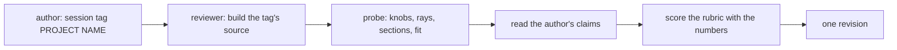

# Design Review: A Peer's Rubric

**Type**: Practice Policy (review)
**Scope**: Any agent or person reviewing a design made with agentcad, and any author preparing one for review
**Status**: ACTIVE
**Commands**: none

## Purpose

An author cannot measure what the author did not think to ask. A review is an instrument pointed at those blind spots: a peer who builds and probes the design independently, scores it on a fixed rubric with evidence, and asks for the one change that matters most. Its value is in the findings the author could not have made; a review that confirms the render has measured nothing. This policy says what an author hands over, the order a reviewer works in, the rubric, and what a review produces.

## Reaching for It

- Before calling a design done: freeze it with a tag and hand a reviewer the packet (section 1), with the review skill.
- Asked to review someone else's design: section 2's order, the reviewer's instruments first and the author's conclusions last.
- Checking your own iteration as you go: that is the session's reading of each iteration (`agentcad-session`), not a review; a review is a second instrument.
- Judging a rebuild against an original: `agentcad compare` is one of the reviewer's instruments (`agentcad-compare`).

## CEP Navigation Guide

**1 The Packet**
- What does an author hand a reviewer?
- Why is the design frozen first?

**2 The Order of Work**
- What does a reviewer do before reading the author's conclusions?
- Which probes find what a render hides?

**3 The Rubric**
- On what is a design scored, and with what evidence?

**4 Findings and the One Revision**
- How are findings ranked and grouped?
- What is the one revision, and how is it chosen?

**5 What a Review Produces**
- What does the record of a review hold, and what does a reviewer not do?

**6 Recipes**
- How is a packet frozen, and how does a reviewer build and probe it before reading anything the author concluded?

**7 Constraints to Probe**
- Which of the reviewer's checks is answered by which command?

**8 Integration with Other Policies**
- Which policies give a reviewer its instruments?

**9 Anti-Patterns**
- Which reviews measure nothing?

**10 Evolution and Feedback**
- How does this policy change?

=== CEP_NAV_BOUNDARY ===

## 1 The Packet

The author hands over the program, the renders, the spec, the measurements, the author's own critique and, for a replication or a revision, the original. Freeze the design first: tag the session (`agentcad session tag`) and give the reviewer the tag, so the reviewer scores a fixed revision while work continues. A design rewritten during a review gets a review of a superseded version. Give the packet's current images; overlays reused from an earlier revision make the reviewer diff programs to trust them.

## 2 The Order of Work

Build the program and probe the result before reading anything the author concluded. Section the part at mid-thickness against the original; cast rays for widths and wall thicknesses; scan along each cavity's axis for throats, seats and caps; list the edges under a quarter of a millimetre for skins and slivers; perturb the parameters (`agentcad probe knobs`) to find knobs that move nothing and values that break the part silently. Then read the author's spec against the author's build, re-run the author's own instruments against the author's claims, and read the author's critique last, so the reviewer's list is the reviewer's own.

Hunt the silent-valid part: a solid that reports valid while a feature never built, a vent stops short of its wall or two bodies only touch. Validity is the claim to test, not the reassurance.

## 3 The Rubric

Score four things, each with evidence: a program line or a measured number ("8.2 against 6.0 at x -4", not "looks fuller").

- **Function**: does the part do its job? Is the direction of every mate stated and right, and does each feature serve the job the spec gives it?
- **Constructive-technique choice**: are the operations the right ones for the shape (a profile revolved with its features in it, a round made as a prism and not a propagating fillet, curves recovered rather than traced)?
- **Parametrization sanity**: are the knobs the quantities a user turns, are derived values derived, does any knob move nothing, is any number written twice?
- **Printability**: is the orientation argued, are walls and features above the process's minimums, where do supports land, what does the material do?

## 4 Findings and the One Revision

List up to five findings, ranked by consequence. For a replication or a revision, sort them into three bins: where the design is better than the reference, where it is worse, and the weaknesses both share. Never recommend copying the reference; recommend what is right.

Name one revision: the single construction change that retires the most findings. Build it and measure it before recommending it, so the recommendation carries its own evidence. Then say what the author's critique missed: it is how the author learns where to look next time.

## 5 What a Review Produces

A review's record holds the rubric scores with their evidence, the ranked findings, the one revision with its measurements, and what the critique missed, so the author can act on every line. A reviewer changes nothing in the design, the project or its records; the author applies the revision, and the next iteration shows whether it retired the findings.

## 6 Recipes

The author freezes the revision; the reviewer works from the tag, builds the program fresh, and measures before reading any claim.

```console
# recipe: examples
$ agentcad session start examples/j_hook
Session started
$ agentcad session iterate examples/j_hook examples/j_hook/source/j_hook.py
Iteration v1 recorded
$ agentcad session tag examples/j_hook review-1 --note "packet for the first review"
Tagged v1 as 'review-1'
$ agentcad render examples/j_hook/tags/review-1/source/j_hook_v1.py --views iso --report -o reviewer
counts     solids 1, faces 10
valid      True
$ agentcad probe knobs examples/j_hook/tags/review-1/source/j_hook_v1.py --knob wire_d=0.5 --knob lip=2
knob wire_d: base 5, delta 0.5
live: both sides change the part
knob lip: base 12, delta 2
live: both sides change the part
```

The reviewer's numbers come from the frozen source alone: one valid solid, and the knobs tried are live. A knob that moved nothing would be the first finding. Next: rays and sections on the load-bearing features, then the author's claims, then the rubric (sections 2 and 3).



## 7 Constraints to Probe

- The packet must not move while it is reviewed: `agentcad session tag PROJECT NAME` freezes it and refuses to overwrite an existing tag.
- A dead knob or a derived value posing as one: `agentcad probe knobs SOURCE --knob NAME=DELTA` says live or dead.
- A wall, a width or a seat that is not the size claimed: `agentcad probe rays SOURCE --line ...`.
- Connectivity a render cannot show: `agentcad render SOURCE --report` prints the solid count.
- A mate that only one part states: `agentcad fit A B --mate NAME` with both bodies.
- A replication that misses a feature: `agentcad compare ORIGINAL CANDIDATE --planes ...`, gate first.

## 8 Integration with Other Policies

- `agentcad-start`: where a review sits among the goals.
- `agentcad-session`: tags, the frozen copies a review scores.
- `agentcad-compare`, `agentcad-probe-inspect`, `agentcad-probe-recover`, `agentcad-probe-construction`: the reviewer's instruments.
- `agentcad-design-practice` and `agentcad-build123d`: the practices the rubric scores against.
- `agentcad-fit`: the evidence for a mate.
- `agentcad-policies`: how this policy is found and read.

## 9 Anti-Patterns

- **Reviewing the render**: four views confirm a silhouette; they say nothing about walls, sizes or connectivity.
- **Reading the author first**: the review becomes the author's list in a second voice.
- **A finding without a number**: an impression the author cannot act on.
- **Many revisions**: a list of changes is not a decision; name the one.
- **A moving target**: a design rewritten while it is reviewed.

## 10 Evolution and Feedback

This policy changes as reviews teach; a recurring finding is added to the rubric's wording when it has appeared in more than one review.
