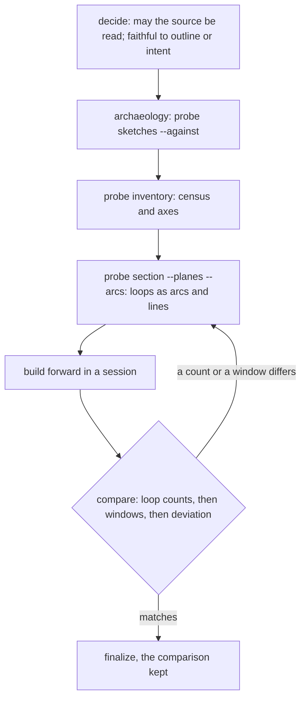

# Reverse Engineering: Recovering a Part's Intent

**Type**: Practice Policy (replication)
**Scope**: Any agent or person replicating an existing part, revising a part whose source is lost, or editing a solid without its source
**Status**: ACTIVE
**Commands**: none

## Purpose

An existing part is a record of decisions: a hub radius, a fillet family, an offset by a beam width. Reverse engineering recovers those decisions so the new part can be built from them, rather than tracing the old part's outline to a tolerance and inheriting its accidents. agentcad's probes read the evidence (sketches where they survive, exact section curves, polylines that were arcs) and its comparison judges the result feature by feature. This policy gives the order of work, how each kind of evidence is read, and how an edit to a solid with no source is made safely.

## Reaching for It

- A part that exists only as a STEP, a mesh or a design record, to be replicated or revised: this practice, with the reverse-engineer skill.
- A part whose source you have: change the source in a session instead (`agentcad-session`).
- Removing one feature from a solid with no source, without rebuilding it: section 7.
- Only measuring a part, not rebuilding it: the probes on their own (`agentcad-probe-inspect`, `agentcad-probe-recover`).

## CEP Navigation Guide

**1 Before Starting**
- What must be decided before an original is read?

**2 Archaeology**
- Where does a design's own record survive, and what does each kind keep?
- How is a hypothesis labelled by where it came from?

**3 Inventory and Sections**
- What does a face census say about how a part was made?
- How are section loops read for parameters?

**4 Polylined Loops Are Arcs**
- How is a loop of many short lines read back into arcs?
- Which fits lie?

**5 Building Forward**
- How do the hypotheses and the recovered curves become a program?
- What is done with a body that was converted from a mesh?

**6 Verifying per Feature**
- How is a replication judged, and against which numbers?

**7 Editing a Solid Without Its Source**
- How is a feature removed from a solid that has no parametric source?
- How is such an edit verified and recorded?

**8 Recipes**
- What does recovering a part from its STEP and judging the rebuild look like, as commands?
- How are a mesh's polylines read back as arcs?

**9 Constraints to Probe**
- Which step of the method is checked by which command?

**10 Integration with Other Policies**
- Which commands carry out each step?

**11 Anti-Patterns**
- Which shortcuts recover the wrong intent?

**12 Evolution and Feedback**
- How does this policy change?

=== CEP_NAV_BOUNDARY ===



## 1 Before Starting

Decide two things first. Whether the original's source may be read for this work: an exercise may forbid it until the attempt is scored, and a commission may require it from the start. And what the replication is faithful to: the original's outline, or the intent the outline approximates (`agentcad-design-practice`, section 1). The answer decides whether a defect in the original is copied or corrected.

## 2 Archaeology

Before hypothesising from the solid alone, look for the design's own record. A design dump keeps its sketches even when the timeline and parameters were lost (a direct-mode design), and the sketches carry the drawn skeleton: circles, flank lines, angles. Fillets, scoops and push-pulls are edits to the body and appear only in the solid's sections. A timeline that starts from an imported base body hides the geometry in the design it was imported from; follow that chain before concluding the intent was lost.

Read the sketches with `agentcad probe sketches`: every number it prints is DRAWN, and with `--against` the part, the ones the part's sections still carry are marked APPLIED (`agentcad-probe-recover`). Label each hypothesis by its evidence: a drawn number the part carries, a drawn number the part lost (a later feature changed it, or it was only ever construction), or a body edit no sketch draws (a fillet, a scoop, a push-pull), read from the sections alone. Never assume a symmetry the sketch does not draw: two arms of one part can carry different ramps.

## 3 Inventory and Sections

`agentcad probe inventory` gives the box, the volume, the face census and the cylinder axes. The census says how the part was made: a designed part is mostly planes, cylinders and a few tori; a census dominated by planes, with many-sided holes and outlines of short lines, is a body converted from a mesh, which no sketch will draw and whose curves must be fitted as data.

Section the part at the middle of its thin axis with `agentcad probe section` and read the loops of exact edges, each with its type, centre, radius and sweep. Look for shared centres (concentric bands about an axis), repeated radii (a fillet family) and a centre that recurs in another loop (a slit end concentric with a notch fillet means an offset by a beam width). Each coincidence is a parameter; write it down with the numbers that would follow from it. Never cap the loop listing you will compare counts from.

## 4 Polylined Loops Are Arcs

A loop of hundreds of tiny lines, whose lengths cluster at a few values, is arcs discretised on export; each length cluster goes with one radius. `agentcad probe section --arcs` segments such a loop by curvature, fits a circle per run and judges each joint tangent or not.

Fit per edge run, never across two curves: a circle fitted over a span that crosses an edge and its fillet returns an arc the part does not have. Fit a mesh-converted edge's circle to that edge's own vertices; a fitted centre that lands on one of the part's axes means the arc is tangent there, which also fixes where it starts and ends. A run that crosses a corner fits a circle to a lie.

## 5 Building Forward

Build the hypotheses as generated geometry: a lobed profile from its few numbers, a symmetry by rotation where the data shows one. Take the remaining loops as chains of lines and arcs with exactly shared endpoints (`agentcad probe section --chain`), with slivers merged into their neighbours: tiny lines between paired fillets are modelling residue, not intent. Then assert, in the program, the radii the hypotheses predict against the recovered chains, so the parameters stay true statements about the part.

On a part that mixes a designed body with a mesh-converted one, split the work by body: the designed body is built from its drawn numbers, the converted one is carried as a data chain. Where drawn reference circles sit over a mesh polygon, the drawn number is the intent.

## 6 Verifying per Feature

Judge the rebuild with `agentcad compare`: the loop counts of the rebuild's own sections against the original's on the same planes first (a different count is a missing or extra feature), then a window per feature (tip, slot end, window, rib end) with its 95th percentile and maximum, then the sampled deviation both ways (`agentcad-compare`). For a replication, aim for every window under the original's own export discretisation and the deviation at its sampling floor. A fit measured on the replication (the interference of a gear pair, say) is judged against the same fit measured on the original pair: the original's own residual is the baseline, not zero. Once the curves are exact, a single rebuild usually closes it; iterations spent before that are spent on curves that were never right.

## 7 Editing a Solid Without Its Source

When the parametric source is lost or locked and only a STEP remains, a small edit (removing a boss, filling a pocket) can be made on the solid itself with the kernel's tools; agentcad has no editing command, so this runs outside it, and the same discipline applies.

1. Inventory the solid: the census and every face's area, centre and box. Face-type counts often identify the features by themselves (thirty bosses, thirty BSpline domes).
2. Match against an independent reference (a sketch export, a drawing, a datasheet) before cutting, deriving the mapping from coincident centres rather than assuming axes. Without any reference, show the candidate faces and get the edit confirmed.
3. Guard the cut: assert the feature count, the same face count and surface types for every instance, and every face matched to the reference; abort on any mismatch. A tripped guard is a finding (a fourth face per feature the first plan missed would have left a groove).
4. Remove each feature's complete face set at once with the kernel's defeaturing, which extends the neighbouring surfaces to close the wound; a face left behind becomes a groove or a stub. Defeaturing can fail politely, reporting not done or done but invalid, usually because the feature is tangled with other geometry; fall back to a cut with a tool solid. An addition is a fuse or a cut with a tool solid built for it, under the same guards and checks.
5. Verify: the result is valid; the face count dropped by the faces removed; the volume changed by about the feature's material and with the right sign (removing a recess adds volume, removing a boss subtracts it, and a surprising sign means the feature was misread); rays through and between the features read alike afterwards; and a render of the region, before and after, was looked at.
6. Record the fork: the derived file is not in the design's history, so note how it was made and verified, and that it should be recreated in the parametric source if it becomes the canonical part.

Measure such a solid on its tessellation: a bounding box of an untessellated spline surface can bound its control points, not the surface. A volume integrated from the solid is exact and is the cross-check. And a feature is not its most visible face; enumerate the faces of the region before classifying them.

## 8 Recipes

A plate known only by its STEP: its census and axes say how it was made, a section through it gives the loops as exact lines and arcs, and the program rebuilt from those numbers is judged against it. (The STEP is written first here only so the recipe has an original to read.)

```console
# recipe: examples
$ agentcad export examples/peg_plate/source/peg_plate.py -f step -D part=plate -o original.step
Exported:
$ agentcad probe inventory original.step
bbox_size [60.0, 20.0, 6.0]
census {'plane': 6, 'cylinder': 3
cylinder r 2.5: axis through (-15, 0, -4) along (0, 0, 1)
cylinder r 2.5: axis through (15, 0, -4) along (0, 0, 1)
$ agentcad probe section original.step --planes z=0 --arcs
z=0 (at 0): 4 loop(s)
r 2.5000  center (-15.0000, 0.0000)  sweep 360.00 deg
$ agentcad compare original.step examples/peg_plate/source/peg_plate.py --planes z=0 -D part=plate
z=0: loops 4 vs 4 ok
deviation candidate->original p95 0
```

The census says a block with three through holes and no fillets; the axes give their pitch (15 mm) and the section their radius (2.5 mm) as exact numbers, so the program states them as parameters rather than traced curves. The rebuild's loop counts match on the plane, and its deviation sits at the sampling floor. Next: a window per feature that matters (`agentcad-compare`).

The same plate as a mesh: each hole is 126 short lines, and `--arcs` reads them back as the circle they approximate, with how well it fits.

```console
# recipe: examples
$ agentcad export examples/peg_plate/source/peg_plate.py -D part=plate -o original.stl
Exported:
$ agentcad probe section original.stl --planes z=0 --arcs
loops are polylines from triangle-plane intersection
loop 2: length 15.71, 126 line; fits a circle r 2.5
1 arc  ccw convex  r 2.5000  center (15.0000, -0.0000)  sweep 360.00 deg
```

A fit's rms is read before its radius: a circle fitted across two curves (an edge and its fillet) fits badly, and that is the warning that the loop holds two features (section 4). Next: the recovered numbers into the program, then compare against the STEP if there is one.

## 9 Constraints to Probe

- What the design's own record still carries (section 2): `agentcad probe sketches DUMP --against PART.step` marks each drawn number APPLIED or not.
- How the part was made (section 3): `agentcad probe inventory PART.step` gives the face census and every cylinder's and cone's axis.
- Which curves a loop is made of (section 4): `agentcad probe section PART --planes ... --arcs` recovers arcs and lines with their fit; a long chain is read whole with `--chain N`.
- Whether the rebuild has every feature (section 6): `agentcad compare ORIGINAL REBUILD --planes ...` fails its gate on a missing or extra loop.
- Whether a feature removed from a source-less solid is gone and nothing else changed (section 7): `agentcad compare` of the edited solid against the original, with a window on the removed feature and on its neighbours.

## 10 Integration with Other Policies

- `agentcad-start`: where recovering a part sits among the goals.
- `agentcad-probe-recover`: `probe sketches`, `probe section --arcs` and `--chain`.
- `agentcad-probe-inspect`: `probe inventory`, rays and knobs.
- `agentcad-compare`: the gate, the windows and the deviation.
- `agentcad-build123d`: building the recovered chains so they share endpoints.
- `agentcad-design-practice`: what the replication is faithful to.
- `agentcad-policies`: how this policy is found and read.

## 11 Anti-Patterns

- **Tracing instead of recovering**: an outline matched to a tolerance carries every accident of the original and none of its parameters.
- **A symmetry assumed**: two arms of a part can differ; read each.
- **A fit across two curves**: one circle over an edge and its fillet is an arc the part does not have.
- **A capped loop count**: a listing that kept N loops hides loop N + 1.
- **Cutting before matching**: a feature identified from the solid alone is a guess.

## 12 Evolution and Feedback

This policy changes as replications teach; a step is added here when it has recovered intent on more than one part.
