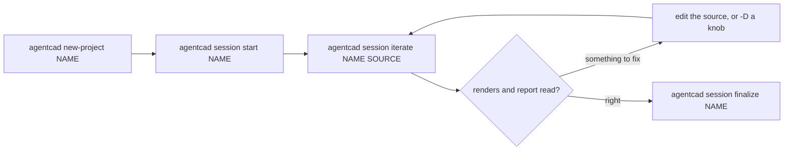
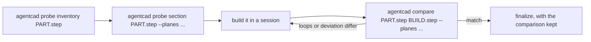
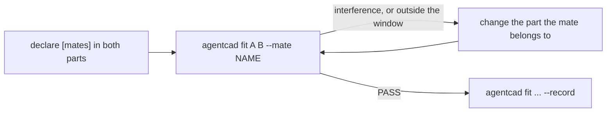
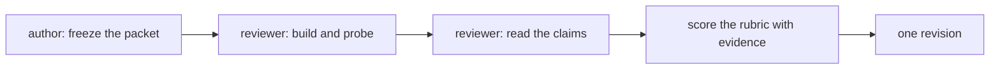
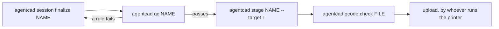
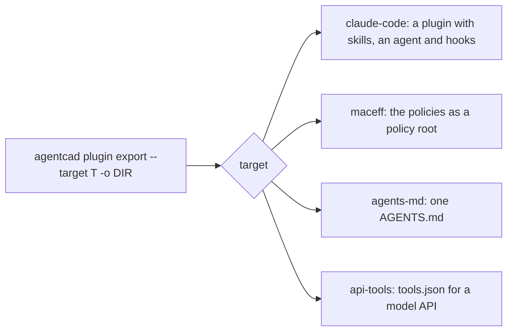

# Start: agentcad by Goal

**Type**: Practice Policy (orientation)
**Scope**: Any agent or person arriving at agentcad with a goal and no map of its commands
**Status**: ACTIVE
**Commands**: none

## Purpose

agentcad has many commands and a policy for each family of them. This policy is the map an arriving agent reads first: for each goal it names the skill that walks it, the policies behind that skill, the first command to type, and the route as a diagram. It holds no rule of its own; every step it names is governed by the policy it points at.

## Reaching for It

- Read this first, before any other policy, when you know what you want made or checked but not which command does it.
- Read it again when a task changes kind: from designing to checking a fit, from a finished part to a printer.
- When you already know the command, go to its policy instead: `agentcad policy list` names the policy that governs each command.

## CEP Navigation Guide

**1 Goals**
- Which goals does agentcad serve, and where does each one start?

**1.1 Design a New Part**
- Which skill, policies and first command design a part from nothing?

**1.2 Change a Part That Exists Only as a STEP or a Mesh**
- How is a part with no source recovered, rebuilt and judged against the original?

**1.3 Check a Fit**
- How are two mating parts measured together?

**1.4 Review a Design**
- How is a design reviewed, by its author or by someone else?

**1.5 Get a Part Printed**
- What lies between a finished part and a print?

**1.6 Make agentcad's Know-How Available in a Harness**
- How does another agent harness get the skills, the policies and the tool definitions?

**2 Choosing an Engine**
- Which engine does a new part start in?

**3 Recipes**
- What does the first quarter hour with agentcad look like, as commands?

**4 Constraints to Probe**
- What should be checked before trusting the map?

**5 Integration with Other Policies**
- Which policies does each goal lean on?

**6 Anti-Patterns**
- Which ways of starting cost the most later?

**7 Evolution and Feedback**
- When does this map change?

=== CEP_NAV_BOUNDARY ===

## 1 Goals

Each goal below names a skill (the plugin's skills, exported by `agentcad plugin export`, `agentcad-plugin`), the policies the skill reads, the first command, and the route. A skill asks the questions; the policies answer them; the commands do the work. Without the plugin, read the named policies in the order given and type the commands yourself.

| Goal | Skill | Policies | First command |
|---|---|---|---|
| Design a new part | design-session, then render-gate | agentcad-engines, agentcad-session, agentcad-design-practice | `agentcad new-project NAME` |
| Change a part that exists only as a STEP or a mesh | reverse-engineer | agentcad-reverse-engineering, agentcad-probe-recover, agentcad-compare | `agentcad probe inventory PART.step` |
| Check a fit | fit-check | agentcad-fit | `agentcad fit A B --mate NAME` |
| Review a design | review | agentcad-design-review | `agentcad session status PROJECT` |
| Get a part printed | print-prep | agentcad-qc, agentcad-print-intent, agentcad-targets | `agentcad qc PROJECT` |
| Make the know-how available in a harness | none (this is how the skills are made) | agentcad-plugin | `agentcad plugin export --target claude-code -o DIR` |

### 1.1 Design a New Part

Start a project, choose the engine by what the part needs (section 2), and iterate: each iteration renders and measures, and the renders are looked at before the next change (the render gate). Finalize when the part is right; the finalize writes the exports, the print manifest and the viewer.



### 1.2 Change a Part That Exists Only as a STEP or a Mesh

Recover what the part is made of before drawing anything: its inventory, its sections and their arcs. Build it forward in a session in build123d, then compare the build with the original plane by plane. The loop counts of a section are the gate; a deviation figure without them can hide a missing feature.



### 1.3 Check a Fit

A mate stated in one part is a guess until both bodies are posed together. Declare the mate in both parts, pose them from those declarations, and measure interference, clearance in the mate's window, and the insertion path.



### 1.4 Review a Design

The author freezes a packet: the source, the renders, the measurements and the claims. The reviewer builds and probes the part before reading the author's conclusions, scores the rubric with evidence, and asks for one revision.



### 1.5 Get a Part Printed

A finished part is judged against its printer's design rules, its print intent is stated, and it is staged for an output target. A slicer's output is read before it prints, never assumed.



### 1.6 Make agentcad's Know-How Available in a Harness

The plugin export writes the skills, the reviewer agent, the hooks and the policies for a harness; other targets write a policy root for the [MacEff](https://github.com/cversek/MacEff) agent framework, an `AGENTS.md`, or tool definitions for a model API.



## 2 Choosing an Engine

The engine follows from what the part must be, not from habit: build123d for a part that will be measured, mated, reverse-engineered or exported as STEP; OpenSCAD for a parametric family or a part built from a library of OpenSCAD modules; VoxelCAD for lattices, gyroids and shapes easier to state as a field than as faces. The comparison, what each cannot do, and a recipe for each are in `agentcad-engines`.

## 3 Recipes

The first quarter hour: see what is installed, then design by iterating. The examples in the repository are real projects; copy one and run it.

```console
# recipe: examples
$ agentcad info
Registered engines: ['openscad', 'voxelcad', 'build123d']
$ agentcad session start examples/hex_tray
Session started for project 'hex_tray'
$ agentcad session iterate examples/hex_tray examples/hex_tray/source/hex_tray.scad
Iteration v1 recorded
counts     solids 1
# a knob turned without editing the source: two rows instead of three
$ agentcad session iterate examples/hex_tray examples/hex_tray/source/hex_tray.scad -D rows=2
Iteration v2 recorded
bbox       [66, 36.71, 12]
$ agentcad session status examples/hex_tray
Iterations: 2/10
```

Each iteration's report is read with its renders: the second one says the tray lost 13.86 mm of depth and kept one solid, which is what two rows should do. Next: look at the four renders the iterate printed, then finalize (`agentcad-session`).

Checking a fit, the second most common goal, on the peg and plate example (one source builds both parts, so each side says where its part declares its half of the mate):

```console
# recipe: examples
$ agentcad fit examples/peg_plate/source/peg_plate.py examples/peg_plate/source/peg_plate.py --a-define part=plate --b-define part=peg --mate middle_peg --a-mates examples/peg_plate/parts/plate --b-mates examples/peg_plate/parts/peg
interference 0 mm^3
window middle_peg: PASS
```

## 4 Constraints to Probe

- The engines installed here decide which goals can run at all: `agentcad info` says which are available and which formats each exports.
- The policies are those of the installed version, not of a copy you remember: `agentcad policy list` lists them, and `agentcad policy navigate NAME` shows what each answers.
- A skill named here exists only once the plugin is exported and loaded: `agentcad plugin export --target claude-code -o DIR` writes it, and the harness's own plugin list shows it.

## 5 Integration with Other Policies

- `agentcad-policies`: how every policy, this one included, is found and read.
- `agentcad-engines`: the engine choice of section 2 in full.
- `agentcad-session`, `agentcad-design-practice`: designing (1.1).
- `agentcad-reverse-engineering`, `agentcad-probe-recover`, `agentcad-compare`: recovering a part (1.2).
- `agentcad-fit`: fits (1.3).
- `agentcad-design-review`: reviews (1.4).
- `agentcad-qc`, `agentcad-print-intent`, `agentcad-targets`, `agentcad-gcode`: printing (1.5).
- `agentcad-plugin`: harnesses (1.6).

## 6 Anti-Patterns

- **Starting from the command list**: picking a command by its name rather than the goal finds a command that runs and a result that answers another question.
- **Drawing a part that already exists**: a STEP or a mesh of it is a better start than a fresh sketch (1.2).
- **One part at a time for a mating pair**: each part passes alone and the pair does not fit (1.3).

## 7 Evolution and Feedback

This map changes when a goal, a skill or a first command changes: a new command that serves a goal adds its line here in the same pull request.
